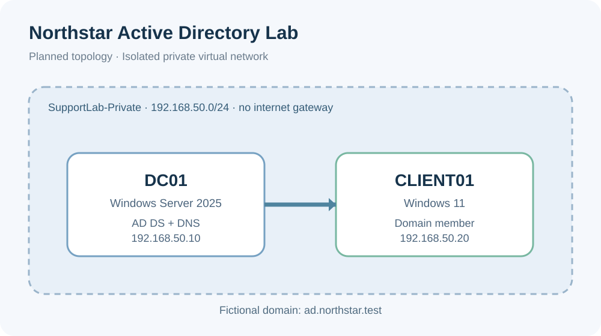

# Northstar — Isolated Windows Active Directory Lab

**Status: documentation and script starter; not yet deployed or tested.**

## Aim
Create an isolated fictional company environment for desktop support practice: one Windows Server domain controller (DC01), one Windows 11 workstation (CLIENT01), 10 dummy users, basic organisational units and realistic support incidents.

## Safety
- Use an **internal/private virtual switch**, not bridged networking.
- Never expose RDP, LDAP, SMB or a domain controller to the public internet.
- Use fake names, dummy data and test-only credentials.
- Never commit real passwords, private keys, VM disks, or company data.
- Run scripts **only after reviewing them** on your own lab domain.

## Planned environment
| Device | OS | IP | Purpose |
|---|---|---|---|
| DC01 | Windows Server 2025 evaluation | 192.168.50.10 | AD DS and DNS |
| CLIENT01 | Windows 11 | 192.168.50.20 | Domain workstation |
| Private subnet | 192.168.50.0/24 | No default gateway | Isolated test environment |
| Domain | ad.northstar.test | | Fictional internal name |

## Step-by-step
1. Check available RAM, disk space, and hypervisor support.
2. Create an internal/private virtual switch.
3. Install DC01; set a static IP and its own DNS appropriately.
4. Add the AD DS role and promote DC01 as a new forest `ad.northstar.test`.
5. Create a standard, separate admin account.
6. Review and run `scripts/create-test-users.ps1` inside DC01 (once the domain exists).
7. Install CLIENT01, assign its DNS to DC01, and join the lab domain.
8. Verify DNS, sign-in, groups and Group Policy.
9. Work through `docs/incidents.md` and record screenshots, timestamps, commands and outcomes.
10. Integrate only through a separately authenticated, least-privileged **read-only** worker after both projects function independently.

## Evidence to publish when complete
- Sanitised screenshots of Windows Server Manager, AD Users and Computers, domain sign-in, and `gpresult`.
- Ticketed incident write-ups, each with symptoms, diagnosis, root cause, fix and verification.
- A short walk-through video and architecture diagram.

Do not describe the lab as completed on your CV until it has been run and verified.
