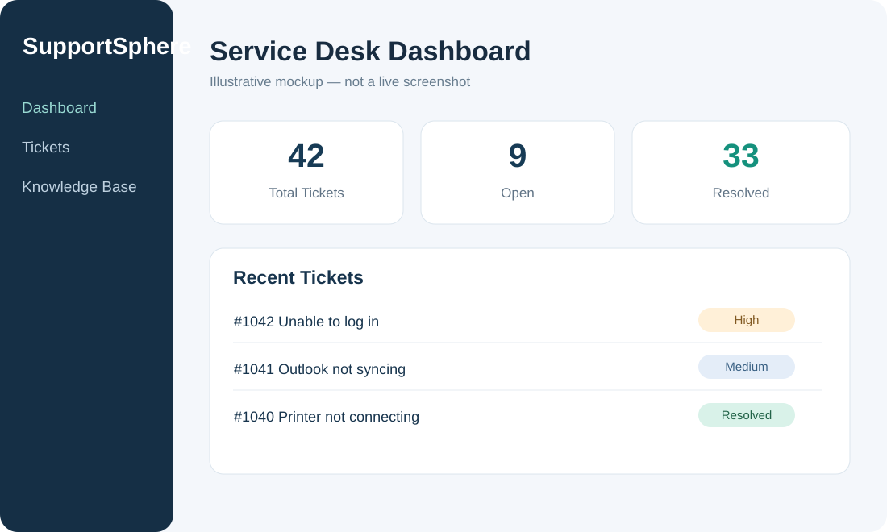
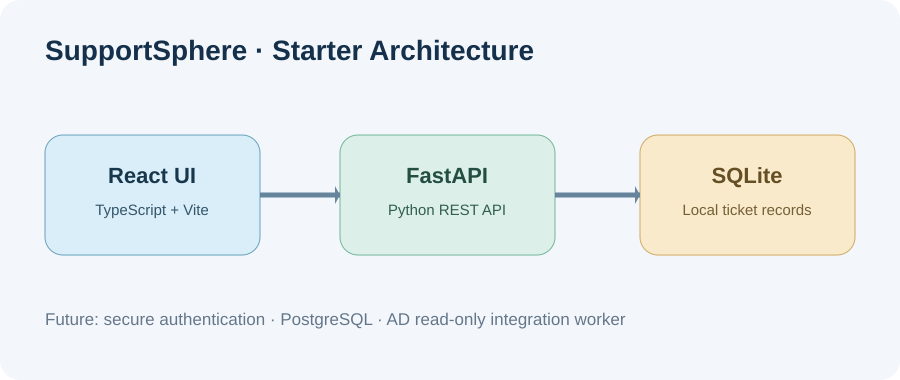

# SupportSphere — Full-Stack IT Helpdesk MVP

**Status: Starter code / development project.** This is a local demo for a junior software engineering + IT support portfolio.



## Functionality included
- FastAPI + SQLite API with ticket create, list, status update and health check.
- React + TypeScript UI for creating tickets, displaying a ticket queue and changing ticket status.
- Sample records are created automatically on the first run.

## Not yet implemented
Authentication, authorisation, PostgreSQL, ticket assignment, comments, audit logs, automated testing, deployment, and live Active Directory integration. **Do not publish this demo on the public internet until access control and security are implemented.**

## Run backend
Requires Python 3.11+.

```bash
cd portfolio-projects/supportsphere-helpdesk/backend
python -m venv .venv
# Windows PowerShell: .\.venv\Scripts\Activate.ps1
# macOS/Linux: source .venv/bin/activate
pip install -r requirements.txt
uvicorn main:app --reload --host 127.0.0.1 --port 8000
```

Visit http://127.0.0.1:8000/docs to explore the API.

## Run frontend
Requires Node.js LTS and npm.

```bash
cd portfolio-projects/supportsphere-helpdesk/frontend
npm install
npm run dev
```

Open the local URL printed by Vite (normally http://localhost:5173).

## Next milestones
1. Add tests and API input validation.
2. Add users and secure authentication/authorisation.
3. Implement technician assignment, comments and audit history.
4. Migrate to PostgreSQL and Docker Compose.
5. Add a separate, read-only Active Directory integration worker only after the lab is isolated.


